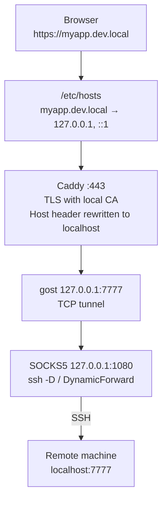

# proxima

**Open services running on a remote machine's `localhost` as real HTTPS domains in your local browser.**


```console
$ cat ~/.proxima/config.json
{ "services": { "myapp.dev.local": 7777 } }

$ proxima start
== Proxima: starting ==
→ Syncing /etc/hosts
→ Generating Caddyfile
→ Registering with launchd
✔ Done — proxima daemon started via launchd

$ open https://myapp.dev.local     # served by port 7777 on the remote machine
```

You develop on a remote box (a cloud VM, a dev server) and the only way in is SSH. Your app listens on `localhost:7777` over there. Normally you juggle `ssh -L` port forwards and visit `http://localhost:7777`, which breaks anything that needs HTTPS, a real hostname, or cookies scoped to a domain.

proxima maps a domain you pick to that remote port. It wires up `/etc/hosts`, a local HTTPS reverse proxy, and a TCP tunnel through your SOCKS5 proxy, then keeps all of it running in the background.

## Features

- **Real HTTPS on any domain.** `myapp.dev.local`, `dev.api.example.com`, whatever you like. Certificates come from Caddy's local CA, so nothing touches a public CA.
- **One config file.** Map each domain to a remote port in `~/.proxima/config.json`. No per-service tunnel commands.
- **Runs in the background.** A launchd agent starts at login and restarts the daemon if it dies.
- **Optional SSH proxy supervision.** proxima can own the `ssh` SOCKS5 session and reconnect it within seconds after sleep, Wi-Fi changes, or expired credentials.
- **Terminal UI.** `proxima ui` shows live status and lets you add, delete, and open services.
- **Bounded logs.** Per-process log files, truncated every hour.

## Requirements

- macOS (proxima uses launchd, `/etc/hosts`, and `open`)
- [Caddy](https://caddyserver.com): `brew install caddy`
- [gost v3](https://github.com/go-gost/gost): `brew install gost`
- [Go 1.24+](https://go.dev/dl/) to build
- A SOCKS5 proxy at `127.0.0.1:1080` into the remote machine. Either run one yourself (`ssh -D 1080 you@remote`) or [let proxima manage it](#let-proxima-manage-the-ssh-proxy).

## Install

```bash
git clone https://github.com/AshShade/proxima.git
cd proxima
go build -o proxima .
sudo mv proxima /usr/local/bin/
```

## Quick start

**1. Trust Caddy's local CA** (once per machine) so browsers accept the certificates:

```bash
caddy trust
```

**2. Describe your services** in `~/.proxima/config.json`. Each key is the domain you want locally; each value is the port the service listens on, on the remote machine's `localhost`:

```json
{
  "services": {
    "myapp.dev.local": 7777,
    "api.dev.local": 3000
  }
}
```

**3. Start your SOCKS5 proxy** (skip this if you set [`ssh_proxy_host`](#let-proxima-manage-the-ssh-proxy)):

```bash
ssh -N -D 1080 you@remote-host
```

**4. Start proxima:**

```bash
proxima start
```

`sudo` asks for your password to update `/etc/hosts`. The command returns right away and the daemon keeps running under launchd. Open `https://myapp.dev.local`.

## Commands

| Command | What it does |
|---|---|
| `proxima start` | Syncs `/etc/hosts`, writes the Caddyfile, and (re)loads the launchd agent. Running `proxima` with no arguments does the same. Re-run it after editing the config. |
| `proxima stop` | Unloads the launchd agent, kills Caddy, gost, and the SSH proxy, and removes proxima's entries from `/etc/hosts`. |
| `proxima status` | Shows daemon, Caddy, and SOCKS5 health, plus the tunnel state of each service. |
| `proxima ui` | Opens the interactive terminal UI. |

### `proxima status`

```
== Proxima: status ==
daemon: ✔ running (launchd)
caddy:  ✔ running
socks5: ✔ reachable (127.0.0.1:1080)

DOMAIN          REMOTE PORT  LOCAL PORT   TUNNEL
───────────────────────────────────────────────
myapp.dev.local 7777         7777         ✔ up
api.dev.local   3000         3000         ✔ up
```

### `proxima ui`

```
╭────────────────────────────────────────────────╮
│ Proxima                                        │
│ daemon: ✔  caddy: ✔  socks5: ✔                 │
│                                                │
│   DOMAIN             REMOTE PORT  TUNNEL       │
│   ──────────────────────────────────────────   │
│ ▶ api.dev.local      3000         ✔ up         │
│   myapp.dev.local    7777         ✔ up         │
│                                                │
│   [a]dd  [d]elete  [o]pen  [↑↓] select  [q]uit │
╰────────────────────────────────────────────────╯
```

| Key | Action |
|---|---|
| `↑` `↓` / `k` `j` | Move the selection |
| `a` | Add a service. Enter a domain, then the remote port. A bare name such as `foo` becomes `foo.dev.local`; anything containing a dot is used as-is. |
| `d` | Delete the selected service (asks for confirmation) |
| `o` | Open the selected service in your browser |
| `q` / `Esc` | Quit |

Status refreshes every second. Adding or deleting a service saves `config.json` (other fields such as `ssh_proxy_host` are kept) and runs `proxima start` in the background. That restart needs `sudo` to update `/etc/hosts`, so the UI works best with the [passwordless sudo rule](#sudo-asks-for-a-password-on-every-start).

## Configuration

`~/.proxima/config.json`:

```json
{
  "services": {
    "myapp.dev.local": 7777,
    "dev.api.example.com": 8080
  },
  "ssh_proxy_host": "my-proxy-host"
}
```

| Field | Required | Description |
|---|---|---|
| `services` | yes | Map of local domain to remote port. The domain can use any TLD. proxima points it at `127.0.0.1` through `/etc/hosts`, so it does not need to resolve publicly (and usually shouldn't). At least one service is required. |
| `ssh_proxy_host` | no | A `Host` alias from `~/.ssh/config`. When set, the daemon runs and supervises the SSH session that provides the SOCKS5 proxy. |

The local tunnel port is always the same as the remote port. Make sure each port is free on your Mac.

### Let proxima manage the SSH proxy

Set `ssh_proxy_host` to a host from `~/.ssh/config` that forwards SOCKS5 on port 1080:

```ssh-config
Host my-proxy-host
  HostName remote.example.com
  User you
  DynamicForward 1080
```

The daemon then runs `ssh -N my-proxy-host` and restarts it whenever it exits:

- **Isolated session.** ControlMaster is turned off, so the proxy never shares a connection with your interactive `ssh` sessions to the same host.
- **Fast failure detection.** Keepalives every 5 s; the session drops after 2 missed replies.
- **Wake from sleep.** If the wall clock jumps by more than 10 s (the Mac slept), proxima kills the stale session right away instead of waiting for keepalives to time out.
- **Backoff.** Retries every 2 s. After 5 consecutive attempts that die within 5 s (wrong host alias, auth failure), it slows to every 5 s.

proxima doesn't try to work out why SSH failed. It keeps retrying, so the proxy comes back within seconds of the network or your credentials recovering.

## How it works



1. **DNS.** `proxima start` writes a marked block to `/etc/hosts` and replaces it on every run:

   ```
   >>> proxima start
   127.0.0.1 myapp.dev.local
   ::1       myapp.dev.local
   <<< proxima end
   ```

2. **HTTPS.** Caddy terminates TLS for each domain and proxies plain HTTP/1.1 to the local tunnel port. The generated `~/.proxima/Caddyfile` contains one block per service:

   ```caddy
   https://myapp.dev.local {
       tls internal
       reverse_proxy http://127.0.0.1:7777 {
           header_up Host localhost
           transport http {
               versions 1.1
           }
       }
   }
   ```

   `tls internal` keeps Caddy on its local CA even for domains that look public, so it never asks a public CA (ACME) for a certificate. `header_up Host localhost` makes the request look local to the remote service, which would otherwise see `Host: myapp.dev.local` and might reject it.

3. **Tunnel.** One gost process per service listens on the local port and connects through the SOCKS5 proxy:

   ```
   gost -L=tcp://127.0.0.1:7777/localhost:7777 -F=socks5://127.0.0.1:1080
   ```

   The SOCKS5 server on the remote side resolves `localhost`, so the connection lands on the remote machine's own loopback interface.

4. **Processes.** launchd runs `proxima daemon` from `~/Library/LaunchAgents/com.proxima.plist` with `RunAtLoad` and `KeepAlive`. The daemon owns every child process:

   ```
   launchd
   └── proxima daemon
       ├── caddy run
       ├── gost             (one per service)
       └── ssh -N <host>    (only with ssh_proxy_host)
   ```

## Files

```
~/.proxima/
├── config.json                      # your services
├── Caddyfile                        # regenerated by every `proxima start`
└── logs/                            # wiped each time the daemon starts
    ├── caddy.log
    ├── caddy-<timestamp>.log.gz     # Caddy's own hourly rotation, last 2 kept
    ├── gost-<domain>.log            # one per service
    └── ssh-proxy.log                # only with ssh_proxy_host

~/Library/LaunchAgents/com.proxima.plist
```

The daemon truncates every log file to zero bytes at the top of each hour.

## Troubleshooting

#### Browser shows "connection refused"
The tunnel for that service is down. Run `proxima status`, then `proxima start`.

#### Tunnel shows `✗ down`, or gost exits right away
The SOCKS5 proxy at `127.0.0.1:1080` is unreachable. Check that your `ssh -D` session is running, and look at `~/.proxima/logs/gost-<domain>.log`.

#### `socks5: ✗` while proxima manages SSH
Read `~/.proxima/logs/ssh-proxy.log`. Usual causes: a typo in `ssh_proxy_host`, a host without `DynamicForward 1080`, or expired SSH credentials.

#### Certificate warning in the browser
Run `caddy trust` once to add Caddy's root CA to the macOS keychain, then restart the browser.

#### HTTP 400 or an unexpected response
The tunnel works, but the remote service rejected the request. Check the port in `config.json` and that the service is running on the remote machine.

#### Caddy won't start
Another process probably holds port 443: `sudo lsof -i :443`. Details are in `~/.proxima/logs/caddy.log`.

#### `sudo` asks for a password on every start
Writing `/etc/hosts` needs root. To allow exactly that copy without a password, run `sudo visudo` and add:

```
your_username ALL=(ALL) NOPASSWD: /bin/cp /tmp/hosts.proxima /etc/hosts
```

## Uninstall

`proxima stop` leaves the launchd plist in place, so the daemon starts again at your next login. To remove proxima completely:

```bash
proxima stop
rm ~/Library/LaunchAgents/com.proxima.plist
rm -rf ~/.proxima
sudo rm /usr/local/bin/proxima
```

## Limitations

- macOS only.
- The SOCKS5 address is fixed at `127.0.0.1:1080`.
- Each service uses the same port locally and remotely, so two services can't share a remote port.
- Remote services always receive `Host: localhost`. Apps that route by hostname won't see the domain you chose.
